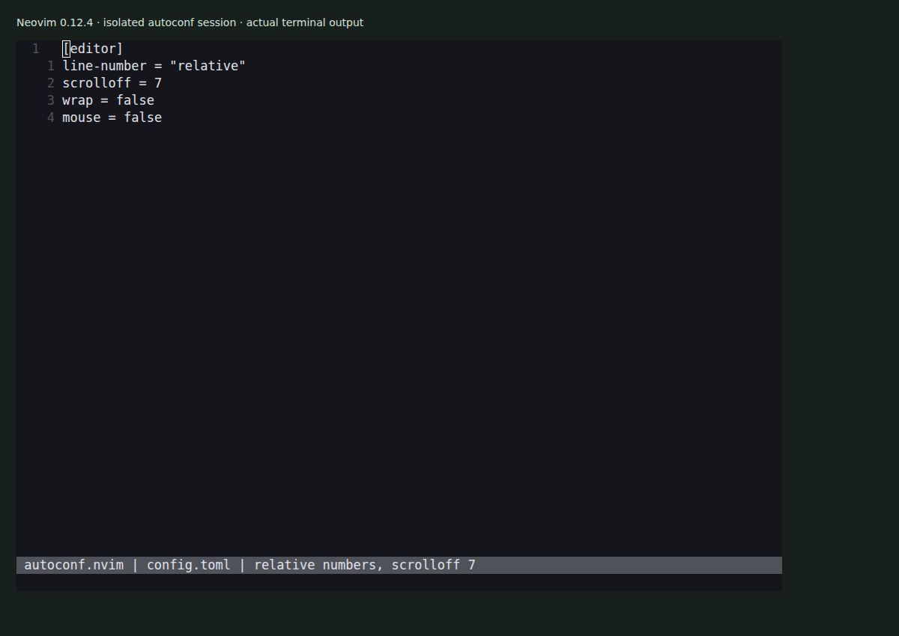

# autoconf.nvim

Configure Neovim with `config.toml` and `languages.toml`. The plugin reads the
files, applies editor settings and keybindings, and configures integrations for
plugins that are installed separately.



The capture uses a real Neovim session. Relative numbers, `scrolloff = 7` and
`wrap = false` were also checked through Neovim's API. See
[the capture notes](docs/demo/README.md).

## Install

Add this repository to your Neovim package manager. For lazy.nvim:

```lua
{
  'olegpustovit/autoconf.nvim',
  config = function()
    require('autoconf').init()
  end,
}
```

This is a plugin, not a replacement for your whole Neovim configuration directory.
The minimal configuration below was checked with Neovim 0.12.4.

## Configure

Create `config.toml` in your Neovim configuration directory:

```toml
[editor]
line-number = "relative"
scrolloff = 7
wrap = false
mouse = false
```

Create `languages.toml` alongside it. Start with an empty language list:

```toml
language = []
```

Restart Neovim after changing the files. The loader checks the configuration
directory, its `lua` subdirectory, and a location under Neovim's data directory.
See [the loader](lua/autoconf/sys/core/loader.lua) for the search order.

Configuration keys are hyphenated, for example `line-number = "relative"`.

## Languages, keys and integrations

[Default settings](lua/autoconf/sys/defaults/init.lua),
[editor resolvers](lua/autoconf/sys/resolvers/editor) and
[command resolvers](lua/autoconf/sys/resolvers/command) describe the implemented
options. Languages can select an LSP server and formatter. Install those tools
and the relevant Neovim plugins separately; a TOML entry does not install them.

This plugin changes editor options and mappings. It also configures supported
completion, formatting, status-line and file-picker integrations. The minimal
capture does not qualify every integration or language-server setup.

Custom resolvers use the exported registration functions:

```lua
require('autoconf').define_resolver('editor.my-setting', function(value)
  -- Apply your setting here.
end)
```

## License and credits

[MIT](LICENSE). TOML parsing uses
[lua-toml](https://github.com/jonstoler/lua-toml) by Jonathan Stoler. Keep its
copyright and license notices when redistributing it.
